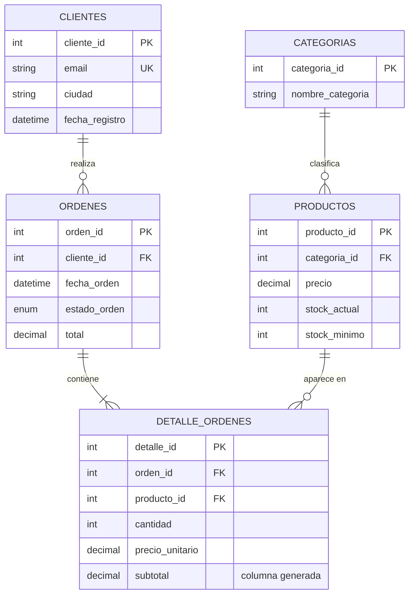
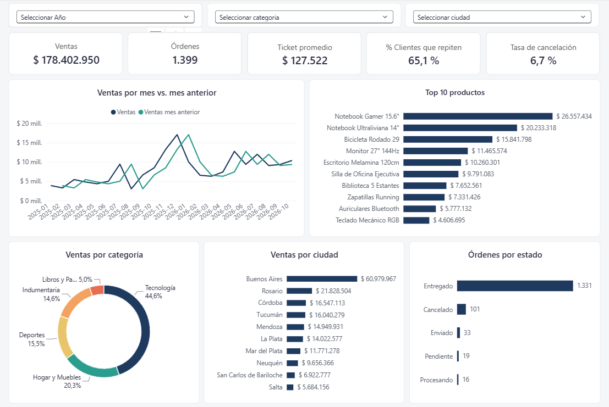

# 🛒 Proyecto SQL: Análisis de un E-commerce

Base de datos relacional para un comercio electrónico, desarrollada en **MySQL 8**, con datos ficticios reproducibles y un conjunto de consultas analíticas (CTEs, funciones de ventana, KPIs de negocio) pensadas para alimentar un dashboard en Power BI.

## 🎯 Qué es este proyecto y qué demuestra

Simula el trabajo completo de un analista de datos sobre una tienda online, de punta a punta:

1. **Diseñar** la base de datos (qué tablas existen y cómo se relacionan).
2. **Cargarla** con datos realistas (ficticios, porque no hay datos reales que compartir).
3. **Consultarla** con SQL para responder preguntas de negocio: ¿cuánto vendemos?, ¿qué productos funcionan?, ¿los clientes vuelven?
4. **Visualizarla** en un dashboard de Power BI.

> 💡 **¿Por qué datos ficticios?** Porque permiten publicar el proyecto sin exponer información de nadie y, además, **cualquiera puede reproducir exactamente los mismos resultados** en su computadora.

## 🧩 Modelo de datos

El modelo describe cinco "cosas" del negocio y cómo se conectan. Se lee así: *un cliente realiza muchas órdenes; una orden contiene uno o más productos; cada producto pertenece a una categoría*.



*(El mismo diagrama, como imagen, está en `docs/diagrama_er_mysql.png`.)*

**Cómo leer el diagrama:** `PK` es la clave primaria (el identificador único de cada fila), `FK` es la clave foránea (el campo que apunta a otra tabla) y `UK` indica que el valor no puede repetirse (dos clientes no pueden tener el mismo email). Las líneas con "patas de gallo" indican "muchos": un cliente puede tener muchas órdenes, pero cada orden pertenece a un solo cliente.

> El diagrama está **simplificado**: muestra solo los campos clave. Las tablas tienen algunos más (por ejemplo, nombre, apellido, teléfono y país en `clientes`, o el indicador `activo` en `productos`). El detalle completo está en `01_schema.sql`.

### ¿Por qué hay una tabla `detalle_ordenes` separada?

Una orden puede incluir varios productos (por ejemplo, un teclado y dos mouses). Si todo estuviera en una sola tabla, habría que repetir los datos de la orden en cada producto, o crear columnas "producto1, producto2, producto3…" sin saber cuántas hacen falta. La solución estándar es separar: **`ordenes` guarda lo que es de la orden completa** (quién compró, cuándo, estado) y **`detalle_ordenes` guarda una fila por cada producto comprado** (qué producto, cuántas unidades, a qué precio).

## 🧠 Decisiones de diseño (y por qué)

Cada decisión responde a un problema concreto. Acá está el razonamiento, sin dar por sabida la jerga.

### 1. Normalización (3FN): cada dato vive en un solo lugar
**Qué significa:** organizar las tablas para que cada dato se guarde **una sola vez**. La ciudad de un cliente está en `clientes`, no copiada en cada orden; el nombre de una categoría está en `categorias`, no repetido en cada producto.

**Por qué:** si un dato está en muchos lugares, hay que actualizarlo en todos y tarde o temprano alguno queda desactualizado (por ejemplo, renombrar una categoría y que la mitad de los productos sigan con el nombre viejo). Con cada dato en un único lugar, se cambia una vez y queda bien en todos lados. "3FN" es el nombre técnico de este nivel de orden (tercera forma normal).

### 2. Una desnormalización deliberada: `ordenes.total`
**Qué significa:** el total de una orden se puede calcular sumando sus líneas en `detalle_ordenes`, así que guardarlo también en `ordenes` es, en teoría, un dato repetido. Rompe la regla anterior **a propósito**.

**Por qué:** para consultas de cabecera ("mostrame mis últimas órdenes con su importe") es mucho más rápido leer un campo ya calculado que sumar líneas cada vez. Es el equilibrio clásico entre orden y velocidad.

**Cómo se evita el riesgo:** el riesgo de un dato duplicado es que se desincronice. Por eso las consultas analíticas **no usan `ordenes.total`**: recalculan los importes desde `detalle_ordenes`, que es la fuente de verdad. Además, el generador de datos verifica que ambos coincidan para cada orden.

### 3. Precio histórico: `precio_unitario` en el detalle
**Qué significa:** cada línea de orden guarda el precio **al momento de la venta**, aunque `productos.precio` (el precio actual) cambie después.

**Por qué:** imaginá que un producto cuesta $100 en enero y $130 en junio. Si el detalle apuntara solo al precio actual, la venta de enero aparecería como si se hubiera hecho a $130 y **todos los reportes históricos quedarían falseados**. Guardar el precio de cada venta preserva lo que realmente pasó. Es especialmente importante en este proyecto porque los datos simulan inflación mensual.

### 4. Integridad: que la base no acepte datos absurdos
La base de datos misma impide errores, en vez de confiar en que quien carga los datos no se equivoque:

- **Claves primarias:** cada fila tiene un identificador único; no hay dos clientes "iguales" por accidente.
- **Claves foráneas:** una orden no puede referirse a un cliente que no existe.
- **Reglas de borrado** (`CASCADE`, `RESTRICT`, `SET NULL`): definen qué pasa con los datos relacionados cuando se borra algo (detalle en la tabla de abajo).
- **Restricciones `CHECK`:** reglas de sentido común: el precio debe ser mayor que cero, y el stock, el stock mínimo y el total de una orden no pueden ser negativos. La cantidad de cada línea debe ser mayor que cero.
- **Columna generada (`subtotal`):** se calcula sola como `cantidad × precio_unitario` y se guarda (`STORED`). Nadie la escribe a mano, así que **nunca puede estar mal**.
- **Estados acotados (`ENUM`):** `estado_orden` solo admite `Pendiente`, `Procesando`, `Enviado`, `Entregado` o `Cancelado`. Un error de tipeo como "Entregdo" ni siquiera se puede cargar.
- **Baja lógica (`activo`):** los productos tienen una marca `activo`. Para retirar un producto del catálogo se lo desactiva en lugar de borrarlo, así sus ventas pasadas siguen intactas (ver tabla de abajo).

**Reglas de borrado, una por una.** La lógica general: se usa `CASCADE` solo cuando la fila hija no tiene sentido sin la madre; `RESTRICT` cuando borrar destruiría historial; `SET NULL` cuando la relación es opcional.

| Relación | Regla | Qué pasa y por qué |
|---|---|---|
| `ordenes.cliente_id` → `clientes` | `RESTRICT` | No se puede borrar un cliente que tenga órdenes. Protege el historial de ventas. |
| `detalle_ordenes.producto_id` → `productos` | `RESTRICT` | No se puede borrar un producto que ya se vendió. Para retirarlo del catálogo se lo marca `activo = FALSE`. |
| `detalle_ordenes.orden_id` → `ordenes` | `CASCADE` | Si se borra una orden, se borran también sus líneas: una línea sin orden no tiene sentido y quedaría huérfana. |
| `productos.categoria_id` → `categorias` | `SET NULL` | Borrar una categoría no borra sus productos: quedan sin categoría y la vista los muestra como "Sin categoría". |

### 5. Índices: para que las consultas no tengan que leer todo
**Qué es un índice:** es como el índice de un libro. En lugar de leer todas las páginas para encontrar un tema, vas directo a la página indicada.

**Por qué estos:** se crearon sobre `fecha_orden` y `estado_orden` porque son los filtros más usados en las consultas ("ventas de este mes", "órdenes canceladas"). Con 1.500 órdenes la diferencia es imperceptible, pero el diseño está pensado para escalar (el generador permite crear decenas de miles).

### 6. Una vista plana para Power BI: `vw_ventas`
**Qué es una vista:** una consulta guardada con nombre, que se usa como si fuera una tabla.

**Por qué:** `vw_ventas` junta clientes, órdenes, productos y categorías en **una sola tabla plana con una fila por línea de orden**. Así Power BI o Excel se conectan a un único objeto, sin tener que armar relaciones entre tablas. La contracara: una tabla plana repite datos (la ciudad del cliente aparece en cada una de sus líneas), algo que en una vista de solo lectura no importa. Para análisis más complejos existe la alternativa de un esquema en estrella (varias tablas relacionadas).

Tres detalles de cómo está armada:
- **Incluye todas las órdenes, también las canceladas.** Expone `estado_orden` justamente para poder calcular la tasa de cancelación. Por eso, **los indicadores de ventas deben excluir las canceladas** al usar la vista (criterio explicado en el punto 7).
- **Usa `JOIN` interno con el detalle:** una orden sin líneas no aparece, lo cual es correcto para analizar ventas.
- **Usa `LEFT JOIN` con categorías y `COALESCE`:** un producto sin categoría no desaparece del análisis, aparece como "Sin categoría".

### 7. Criterio de negocio: las ventas excluyen las órdenes canceladas
Una orden cancelada no es dinero que entró. Todas las consultas de ventas la excluyen, y por eso los números de ventas y los de la tasa de cancelación (consulta 10) se miran por separado. Es una decisión de **definición de negocio**, no técnica: otra empresa podría definir "venta" de otra manera, y conviene que quede escrito.

## 📁 Estructura del repositorio

| Archivo | Contenido |
|---|---|
| `01_schema.sql` | Creación de la base, tablas, restricciones, índices y la vista `vw_ventas` |
| `02_seed_data.sql` | Datos ficticios: 600 clientes, 30 productos, 1.500 órdenes (ene 2025 – oct 2026) |
| `03_queries.sql` | 10 consultas analíticas y de reporte |
| `generate_seed.py` | Generador del seed (Python, solo librería estándar) |
| `LICENSE` | Licencia del proyecto |
| `docs/` | Documentación: diagrama entidad-relación de MySQL (`diagrama_er_mysql.png`) y modelo de datos de Power BI (`diagrama_modelo_powerbi.png`) |
| `powerbi/` | Dashboard (`dashboard_ecommerce.pbix`), medidas DAX (`medidas.dax`), tema de formato (`.json`), guía de armado (`layout.md`) y capturas en `powerbi/img/` |

> **¿Qué es el "seed"?** Es el archivo con los datos iniciales. `02_seed_data.sql` ya viene generado; `generate_seed.py` es el programa que lo crea, por si querés más datos o una versión distinta.

## ▶️ Cómo ejecutarlo

**Requisitos:** **MySQL 8.0.16 o superior**.
- Los `CHECK` se ignoran en silencio en versiones anteriores (la base aceptaría precios negativos sin avisar).
- Las funciones de ventana (usadas en varias consultas) solo existen desde MySQL 8.

> ⚠️ `01_schema.sql` ejecuta `DROP DATABASE IF EXISTS ecommerce_db`: **borra la base si ya existe**. No lo corras sobre una base con datos que quieras conservar.

Ejecutá los scripts en este orden (cada uno depende del anterior):

```bash
mysql --default-character-set=utf8mb4 -u root -p < 01_schema.sql      # 1. crea la estructura
mysql --default-character-set=utf8mb4 -u root -p < 02_seed_data.sql   # 2. carga los datos
mysql --default-character-set=utf8mb4 -u root -p < 03_queries.sql     # 3. corre las consultas
```

`--default-character-set=utf8mb4` evita que se rompan las tildes, las ñ y los emojis al importar. Si preferís una interfaz gráfica, podés abrir cada archivo en MySQL Workbench y ejecutarlo en el mismo orden.

### Regenerar o escalar los datos
```bash
python generate_seed.py                                  # valores por defecto
python generate_seed.py --clientes 2000 --ordenes 20000 --seed 7
```

- **`--seed`** es el número que inicia la generación aleatoria: **misma semilla, mismo archivo**, siempre. Por eso los hallazgos de más abajo se pueden reproducir exactamente (usan la semilla 42).
- El generador **verifica la coherencia** de lo que crea: el total de cada orden coincide con la suma de su detalle, el stock nunca es negativo y ningún cliente se registra después de su primera compra.
- Los datos simulan **estacionalidad** (picos en noviembre y diciembre), **clientes recurrentes**, **precios con inflación mensual** y **estados de orden acordes a la antigüedad** (por ejemplo, una orden de hace un año no puede seguir "pendiente").

## 📊 Consultas incluidas

| # | Consulta | Pregunta de negocio | Técnicas |
|---|---|---|---|
| 1 | Reporte de ventas con cliente, producto y categoría | ¿Qué se vendió, a quién y de qué rubro? | `JOIN`, `LEFT JOIN` |
| 2 | Alertas de stock y sugerencia de reposición | ¿Qué productos hay que reponer? | filtros, expresiones |
| 3 | Ranking de clientes por gasto | ¿Quiénes son mis mejores clientes? | `LEFT JOIN`, agregación |
| 4 | Productos más vendidos | ¿Qué productos mueven el negocio? | `JOIN`, agregación |
| 5 | Ventas mensuales, variación vs. mes anterior y acumulado | ¿Estamos creciendo? | CTE, `LAG()`, `SUM() OVER` |
| 6 | Ticket promedio y órdenes por mes | ¿Cuánto gasta una persona por compra? | KPIs, `COUNT(DISTINCT)` |
| 7 | Top 3 productos por categoría | ¿Cuáles son los líderes de cada rubro? | CTE, `RANK() OVER (PARTITION BY ...)` |
| 8 | Concentración de recaudación por categoría | ¿De qué categorías depende el negocio? | `SUM() OVER ()` |
| 9 | Clientes únicos vs. recurrentes | ¿Los clientes vuelven? | CTE, `CASE` |
| 10 | Órdenes por estado y tasa de cancelación | ¿Cuántas órdenes se pierden? | agregación, ventana |

### Glosario rápido de técnicas
- **`JOIN` / `LEFT JOIN`:** combinar datos de varias tablas. `LEFT JOIN` conserva todas las filas de la tabla de la izquierda aunque no tengan correspondencia (por ejemplo, clientes que nunca compraron).
- **Agregación:** resumir muchas filas en un número (sumas, promedios, conteos), con `GROUP BY`.
- **CTE (`WITH`):** una consulta intermedia con nombre, que hace más legible una consulta larga dividiéndola en pasos.
- **Función de ventana (`OVER`):** calcula algo "mirando" otras filas sin colapsarlas. Ejemplos: `LAG()` trae el valor de la fila anterior (útil para comparar contra el mes previo), `SUM() OVER` arma acumulados, `RANK()` numera posiciones dentro de cada grupo.
- **KPI:** indicador clave de negocio (ventas, ticket promedio, tasa de cancelación).
- **Ticket promedio:** importe promedio por orden (ventas ÷ cantidad de órdenes).
- **Tasa de cancelación:** órdenes canceladas ÷ órdenes totales.

## 🔎 Hallazgos de ejemplo

Resultados sobre los datos ficticios generados con la semilla por defecto (42). Los importes están en pesos nominales y reflejan la inflación simulada. **Son datos inventados:** sirven para mostrar cómo se lee el análisis, no para sacar conclusiones sobre ningún negocio real.

- **Tecnología concentra el 44,6 % de la recaudación**, seguida por Hogar y Muebles (20,3 %). *Lectura:* el negocio depende en buena medida de una sola categoría.
- **Los clientes recurrentes pesan más que su número:** los 116 clientes con 4 o más compras (cerca del 23 % de los compradores) generan el 51,9 % de la recaudación. *Lectura:* retener clientes vale más que sumar nuevos.
- **Dos de cada tres compradores volvieron a comprar:** 323 de 496 clientes (65,1 %) hicieron 2 o más compras, y solo el 34,9 % compró una única vez.
- **La estacionalidad se nota:** diciembre y noviembre de 2025 son los dos meses de mayor facturación.
- **Ticket promedio:** unos $127.500 por orden.
- **Tasa de cancelación:** 6,7 % de las órdenes (101 de 1.500).

> ⚠️ **Dos aclaraciones para interpretar bien los importes:** al ser pesos nominales con inflación, un mes más reciente "vende más" en parte solo porque los precios subieron. Y los 496 compradores son menos que los 600 clientes registrados porque no todos los registrados llegan a comprar (o sus órdenes fueron canceladas).

## 📈 Dashboard en Power BI



Dashboard de una página conectado a la vista `vw_ventas`, pensado para responder de un vistazo cómo viene el negocio:

- **KPIs:** ventas, órdenes, ticket promedio, % de clientes que repiten y tasa de cancelación.
- **Evolución mensual** contra el mes anterior.
- **Top 10 de productos** y cortes por **categoría, ciudad y estado de la orden**.
- **Filtros** por año, categoría y ciudad.

En la carpeta `powerbi/` están el archivo del dashboard (`dashboard_ecommerce.pbix`), las medidas DAX (las fórmulas de los indicadores), el tema de formato y la guía de armado (`layout.md`) para reproducirlo.

### Cómo se calculan los indicadores (medidas DAX)

Una **medida** es una fórmula que Power BI recalcula según los filtros activos: la misma medida `Ventas` muestra el total general, el de un mes o el de una categoría, según lo que se seleccione en el dashboard.

| Medida | Qué mide |
|---|---|
| `Ventas` | Suma de los subtotales, **sin órdenes canceladas** (mismo criterio que las consultas SQL). |
| `Órdenes` | Cantidad de órdenes distintas, sin canceladas. |
| `Ticket promedio` | `Ventas ÷ Órdenes`. |
| `Tasa de cancelación` | Órdenes canceladas ÷ órdenes totales. Es la única medida que **sí** considera las canceladas. |
| `Ventas mes anterior` y `Variación vs mes anterior %` | Ventas del mes previo y cuánto cambió el mes actual respecto de él. |
| `Ventas YTD` | Ventas acumuladas del año hasta la fecha seleccionada. |
| `% de ventas` | Participación sobre el total de lo que está seleccionado (por ejemplo, el peso de cada categoría). |
| `% Clientes que repiten` | Compradores con 2 o más órdenes ÷ total de compradores. |

Tres decisiones que conviene entender:
- **Se cuentan órdenes distintas (`DISTINCTCOUNT`), no filas.** La vista tiene una fila por *línea* de orden, así que una orden de 3 productos ocupa 3 filas. Contar filas inflaría la cantidad de órdenes y distorsionaría el ticket promedio.
- **Hay una tabla `Calendario` aparte.** Las comparaciones en el tiempo (mes anterior, acumulado del año) necesitan una tabla de fechas continua, sin días faltantes. Se genera automáticamente desde el rango de fechas de las ventas y se relaciona con `vw_ventas[fecha]` (relación de uno a muchos). Es todo el modelo de Power BI: dos tablas, `Calendario` y `vw_ventas`, como se ve en `docs/diagrama_modelo_powerbi.png`.
- **Los clientes recurrentes dependen del filtro de fechas.** Si se filtra solo el año 2025, un cliente con una compra en 2025 y otra en 2026 cuenta como "una sola compra". El 65,1 % de los hallazgos corresponde al período completo, sin filtros.

## ⚠️ Alcance y limitaciones

Para ser transparentes sobre lo que este proyecto **no** es:

- Los datos son **simulados**: reflejan patrones plausibles (estacionalidad, recurrencia, inflación) pero no un negocio real.
- Es un modelo **simplificado**: no incluye pagos, envíos, devoluciones parciales, descuentos ni múltiples direcciones por cliente.
- Está pensado para **análisis y aprendizaje**, no como base de una tienda en producción (que requeriría usuarios y permisos, copias de seguridad, auditoría, etc.).

## 🛠️ Tecnologías

MySQL 8 · SQL (DDL, DML, CTEs, funciones de ventana) · Python 3 · Power BI
